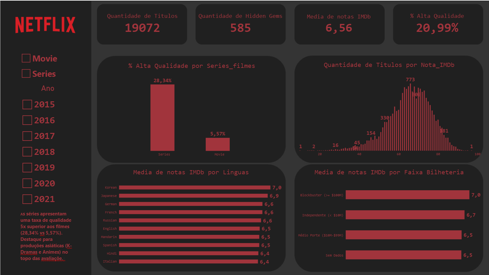
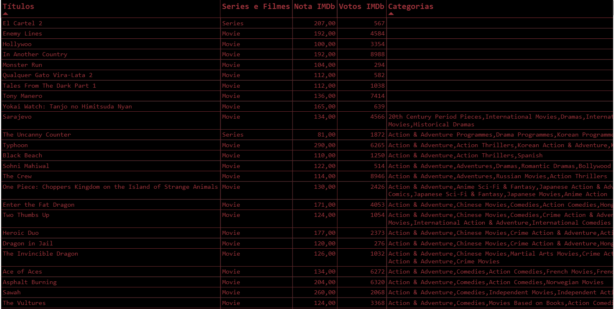

# 🎬 Netflix Catalog & Content Strategy Analysis (SQL Server & Power BI)


Análise exploratória, higienização de dados e BI executivo do catálogo da Netflix. O projeto combina **SQL Server** para o tratamento de dados brutos e **Power BI** para a construção de um dashboard interativo focado em decisões estratégicas de conteúdo, retenção de assinantes e mineração de ativos subaproveitados (*Hidden Gems*).

---

## 📌 Visão Geral do Projeto

Este projeto tem como objetivo transformar dados brutos do catálogo global da Netflix em insights executivos de alto valor. A análise apoia a tomada de decisão em relação à **alocação de orçamento de conteúdo (Séries vs. Filmes)**, **estratégia de recomendação de algoritmo**, **avaliação do retorno de lançamentos de bilheteria** e **expansão internacional**.

O painel no Power BI foi estruturado em formato *Dark Theme* com layout customizado (faixa lateral de filtros e cartões superiores de KPI), garantindo leitura rápida e foco em usabilidade executiva.

---

## 🎯 Perguntas de Negócio Respondidas

1. **Estratégia de Formato (Séries vs. Filmes):** Qual formato entrega maior percepção de qualidade para o assinante e reduz potencial de *churn*?
2. **Mineração de Conteúdo (*Hidden Gems*):** Quantos e quais títulos possuem altíssima aprovação crítica ($\ge 8.0$), mas baixo volume de avaliações, representando alto ROI para alavancagem no algoritmo?
3. **Distribuição Real de Qualidade:** Como as notas se distribuem ao longo do catálogo, expurgando anomalias e dados nulos?
4. **Desempenho por Idioma:** Quais produções internacionais (Coreano, Japonês, Alemão, etc.) lideram em satisfação e nota média do público?
5. **Atratividade por Faixa de Bilheteria:** Filmes *Blockbusters* de cinema performam significativamente melhor na plataforma do que produções independentes?

---

## 📊 Principais Descobertas e Insights Estratégicos

* **Dominância de Qualidade nas Séries:** Enquanto os filmes compõem a maior parte do volume do catálogo, **$28,34\%$ das séries** atingem o patamar de alta qualidade ($\ge 7.5$ no IMDb), contra apenas **$5,57\%$ dos filmes**. Séries mostram-se o motor principal de retenção e engajamento contínuo.
* **Volume de *Hidden Gems*:** Mapearam-se **585 títulos de altíssima nota** ($\ge 8.0$) e baixo volume de votos ($100$ a $10.000$). Ativá-los em campanhas de recomendação na UI do aplicativo gera valor sem novos custos de licenciamento.
* **Liderança de Idiomas Asiáticos:** Produções em **Coreano (nota média $7,0$)** e **Japonês (nota média $6,9$)** lideram o ranking global de qualidade, superando o inglês ($6,5$), indicando o acerto de investimentos em K-Dramas e Animes.
* **Equilíbrio em Bilheterias:** Filmes *Blockbusters* ($\ge \$100\text{M}$) atingem média de nota $7,0$, enquanto produções *Independentes* ($<\$10\text{M}$) registram nota $6,7$, demonstrando que produções menores possuem alta eficiência de atratividade no streaming.
* **Saneamento do Catálogo:** Identificação e expurgo de 2.099 registros zerados (`Nota_IMDb = 0`) e correção de escala dos dados brutos ($10\times$), garantindo uma média geral precisa de **$6,56$** no catálogo.

---

## 🛠️ Arquitetura e Engenharia dos Dados

```
  [ Dataset Bruto / CSV ]
            │
            ▼
┌───────────────────────────┐
│        SQL Server         │
│ ───────────────────────── │
│ • Identificação de Anomalias (Cargas Legadas em Lote)
│ • Tratamento de Nulos & Normalização de Nomes
│ • Consultas de Agregação, CTEs e CROSS APPLY STRING_SPLIT
└─────────────┬─────────────┘
              │ (Import Connection)
              ▼
┌───────────────────────────┐
│         Power BI          │
│ ───────────────────────── │
│ • Tratamento no Power Query (Split into Rows, Cortar/Trim)
│ • Modelagem & Medidas em DAX (KEEPFILTERS, SWITCH, COUNTROWS)
│ • Dashboard Executivo Dark Theme com Filtros Dinâmicos
└───────────────────────────┘
```

---

## 📐 Tratamento de Dados e Modelagem no Power BI

### 1. Higienização no Power Query
* **Divisão de Idiomas em Linhas (*Split Column into Rows*):** Células com múltiplos idiomas em texto (ex: `"English, Spanish"`) foram desnormalizadas para permitir agrupamentos individuais precisos.
* **Remoção de Espaços e Duplicatas (*Cortar / Trim*):** Aplicação da transformação para eliminar espaços ocultos antes e depois dos nomes das línguas, unificando categorias que apareciam duplicadas.
* **Filtro de Caracteres Especiais:** Limpeza de registros corrompidos na fonte original que apresentavam nomes truncados com interrogações (`????`).

### 2. Principais Medidas e Colunas Calculadas em DAX

* **Média de Notas IMDb (Tratada):**
  ```dax
  Media de notas IMDb = 
  AVERAGE(Netflix[Nota_IMDb_Formatada])
  ```

* **Percentual de Alta Qualidade ($\ge 7.5$):**
  ```dax
  % Alta Qualidade = 
  DIVIDE(
      CALCULATE(
          COUNTROWS(Netflix), 
          Netflix[Nota_IMDb] >= 75
      ),
      COUNTROWS(Netflix),
      0
  )
  ```

* **Quantidade de Títulos para Gráficos (Preservando Contexto com `KEEPFILTERS`):**
  ```dax
  Qtd Titulos Grafico = 
  CALCULATE(
      COUNTROWS(Netflix),
      KEEPFILTERS(Netflix[Nota_IMDb] > 0)
  )
  ```

* **Coluna Calculada de Faixas de Bilheteria:**
  ```dax
  Faixa Bilheteria = 
  SWITCH(
      TRUE(),
      Netflix[Bilheteria] >= 100000000, "Blockbuster (>= $100M)",
      Netflix[Bilheteria] >= 10000000, "Médio Porte ($10M-$99M)",
      NOT(ISBLANK(Netflix[Bilheteria])), "Independente (< $10M)",
      "Sem Dados"
  )
  ```

---

## 🎨 Dashboard Executivo no Power BI

Para a criação do Dashboard, os dados foram importados para o Power Bi direto do SQL Server.

O painel foi projetado focado em visualização de dados executiva e navegabilidade:

* **Top Bar (KPIs Globais):**
  * `Quantidade de Títulos` ($19.072$)
  * `Quantidade de Hidden Gems` ($585$)
  * `Média de notas IMDb` ($6,56$)
  * `% Alta Qualidade` ($20,99\%$)
* **Barra Lateral Esquerda (Filtros e Interatividade):**
  * Botões de seleção de **Formato** (*Movie* / *Series*)
  * Filtro de **Ano de Lançamento**
* **Corpo do Painel (Gráficos de Decisão):**
  * **% Alta Qualidade por Formato:** Gráfico de Colunas (*Séries: 28,34% vs. Filmes: 5,57%*).
  * **Distribuição de Notas (Histograma):** Curva de densidade de títulos por nota do IMDb.
  * **Top 10 Idiomas por Qualidade Média:** Ranking de idiomas com maior média crítica.
  * **Média IMDb por Faixa de Bilheteria:** Comparativo de aceitação entre portes de produção.

Imagem do Dashboad

  

  


---

## 📁 Estrutura do Repositório

```
├── Consultas_Netflix.sql   # Scripts SQL
├── Dashboard_Netflix.pbix  # Arquivo interativo do Power BI
├── README.md               # Documentação técnica e visual
└── assets/
    ├── dashboard_overview.png   # Print principal
    └── dashboard_demo.gif       # Demonstração interativa (opcional)
```

---

## 👤 Autor

Desenvolvido por **Vinícius Bortoluci** como parte do portfólio de Ciência de Dados e Business Intelligence.

* **LinkedIn:** [linkedin.com/in/viniciusbortoluci](https://www.linkedin.com/in/viniciusbortoluci)
